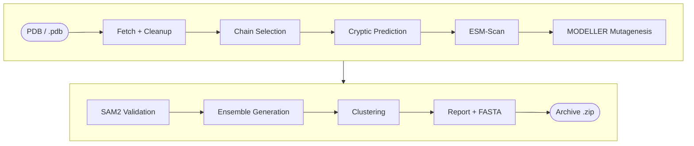

# CryptiScan Pipeline

End-to-end pipeline for predicting cryptic binding sites, designing point mutations with ESM-1v and MODELLER, and generating conformational ensembles with SAM2.



The pipeline runs fully locally inside an Apptainer container (`pipeline_local.sif`), which you build once from this repository plus the model weights archived on Zenodo. After the build, all scripts, dependencies, and model weights are packaged in the image. Internet access is then only required if downloading structures from RCSB; providing a local `.pdb` file path allows fully offline execution.

**Model weights (Zenodo):** [10.5281/zenodo.XXXXXXX](https://doi.org/10.5281/zenodo.XXXXXXX)

---

## Prerequisites

- **Linux** (x86_64)
- **NVIDIA GPU** with driver ≥ 525
- **Apptainer** (or Singularity), with `sudo` or `--fakeroot` rights for the one-time build
- **~70 GB free disk space** for the build, and internet access during the build
- **MODELLER license key** (free academic license at [salilab.org](https://salilab.org/modeller/registration.html))

CUDA 12.5, PyTorch 2.4, ESM-1v, ProtT5-XL, MODELLER 10.8, and SAM2 are all installed inside the container during the build.

---

## Quick Start

### 1. Get the code

```bash
git clone https://github.com/singhnitink/CryptiScan.git
cd CryptiScan
```

### 2. Download the model weights (~15 GB) from Zenodo

The weights are too large for GitHub and are archived on Zenodo ([10.5281/zenodo.XXXXXXX](https://doi.org/10.5281/zenodo.XXXXXXX)).

```bash
wget -O cryptiscan_weights.zip "https://zenodo.org/records/XXXXXXX/files/cryptiscan_weights.zip?download=1"
md5sum cryptiscan_weights.zip     # should match: <MD5 from Zenodo>
unzip -o cryptiscan_weights.zip   # fills required_files_weights/
```

Check the download:

```bash
du -sh required_files_weights          # ~15 GB expected
find required_files_weights -type l    # should return nothing (no broken symlinks)
```

### 3. Build the container (one time)

```bash
sudo apptainer build pipeline_local.sif pipeline_local.def
chmod 0644 pipeline_local.sif
```

Without `sudo`, use `apptainer build --fakeroot pipeline_local.sif pipeline_local.def` if your system allows it.

If `/tmp` is small, point the build to a larger disk:

```bash
sudo -E APPTAINER_TMPDIR=/path/to/large_disk apptainer build pipeline_local.sif pipeline_local.def
```

Verify the image:

```bash
apptainer test pipeline_local.sif
```

### 4. Run

```bash
export MODELLER_KEY="your_key"
bash launch_pipeline_local.sh
```

Edit the target protein and other parameters at the top of `launch_pipeline_local.sh` (see below).

---

## Configuration Options

Edit these variables near the top of `launch_pipeline_local.sh`:

```bash
PDB="1JWP"                     # PDB code or path to a local .pdb file
CHAIN="A"                      # Target chain identifier
TOP=5                          # Number of cryptic residues to mutate
MODE="combined"                # "combined" = one multi-mutant; "independent" = N separate mutants
STRATEGY="esm"                 # Mutation strategy ("esm")
MUTATION_SET="charged_polar"   # Candidate pool: charged_polar | charged | polar | all | "ASP,GLU,..."
N_CLUSTERS=10                  # Number of clusters for SAM2 ensemble
PCA_DIM=10                     # Number of PCA components for clustering
JOBNAME="${JOBNAME:-1jwp}"     # Output folder prefix
MODELLER_KEY="$MODELLER_KEY"  # Sali Lab MODELLER license key
```

Parameters can also be passed as environment variables:

```bash
JOBNAME=1lzt MODELLER_KEY="your_key" bash launch_pipeline_local.sh
```

Before running stage 1, the launcher validates that `pipeline_local.sif` exists, matches required dependencies, and has readable weights.

---

## Output Structure

Results are packaged into `<jobname>_<timestamp>.zip`:

```
<jobname>_<timestamp>/
├── 1jwp_raw.pdb                     Downloaded raw entry from RCSB
├── 1jwp_protein.pdb                 Cleaned protein (all chains)
├── 1jwp_ligands/PO4_A1.pdb          Extracted ligands (one file per residue)
├── 1jwp_prep.json                   Summary of cleaned/dropped residues
├── 1jwp.pdb                         Target chain used for all pipeline stages
├── 1JWP_A_cryptic.json              Predicted cryptic residue positions and probabilities
├── 1jwp_esm_summary.csv             ESM scores for tested substitutions
├── 1jwp_top5_esm_mutant.pdb         Relaxed MODELLER mutant structure
├── sam2_input.pdb                   Structure validated for SAM2
├── ensemble_output.*                SAM2 conformational ensemble trajectory and topology
├── ensemble_clusters/
│   ├── clustering/cluster_representatives.dcd   Representative frame per cluster
│   ├── clustering/cluster_representatives.json  Cluster assignments and population counts
│   └── cluster_meta.sh              Summary counts
├── 1JWP_manifest.json               Run metadata and configuration snapshot
├── 1jwp_local_report.txt            Plaintext summary of the run
├── 1JWP_A_wildtype.fasta            Wild-type sequence of the target chain
└── 1JWP_A_mutant.fasta              Mutated sequence
```

### Key Pipeline Details

- **Cleanup:** Non-standard residues, water molecules, and alternate atom locations are processed with MDAnalysis. Ligands are saved individually in `<pdb>_ligands/` for reference.
- **Chain isolation:** Downstream steps run strictly on the single designated chain (`CHAIN`). Isolating the chain prevents multi-chain coordinate flattening during SAM2 simulation.
- **SAM2 pre-check:** Before running conformational sampling, stage 5b verifies standard atom naming, chain consistency, and CA completeness on the MODELLER output.

---

## Project Structure

| File / Directory | Description |
|---|---|
| `launch_pipeline_local.sh` | Main pipeline bash launcher script |
| `pipeline_local.def` | Apptainer recipe definition |
| `pipeline_local.sif` | Container image (~15 GB), built by the user in Quick Start step 3 |
| `download_weights.sh` | Alternative: fetches weights from the original sources instead of Zenodo |
| `required_files_weights/` | Scripts (in this repository) + model weights (downloaded from Zenodo) |

### Container Scripts & Environments

The container uses two isolated Python environments to prevent dependency conflicts between MDTraj/PyTorch and MDAnalysis:

| Environment | Path | Packages |
|---|---|---|
| `main` | `/opt/conda` | PyTorch 2.4 (CUDA 12.4), ESM-1v, ProtT5, MODELLER 10.8, SAM2, MDTraj (`numpy==1.26.4`) |
| `prep` | `/opt/conda/envs/prep` | MDAnalysis 2.7.0, SciPy (used for structure cleanup and clustering) |

#### Core scripts in `required_files_weights/`:
- `run_pipeline.py`: Orchestrates stages 1 through 4.
- `predict_cryptic_local.py`: Local ProtT5 cryptic pocket predictor.
- `cryptobank_model_loader.py`: Classification head architecture for ProtT5 embeddings.
- `esm_scanner.py`: ESM-1v in silico mutagenesis scanner.
- `modeller_mutate.py`: Point mutation insertion and sidechain minimization with MODELLER.
- `clean_structure.py`: MDAnalysis structure parsing and chain isolation.
- `asam_cluster_analysis.py`: PCA and k-means clustering of SAM2 trajectories.
- `make_report.py`: Generates the summary report and FASTA files.

---

## Mutation Selection with ESM-Scan

ESM-Scan uses the ESM-1v protein language model to score substitutions at identified cryptic sites:

1. Target chain sequence is evaluated by ESM-1v.
2. Log-probabilities are computed for all 20 standard amino acids at each position:
   $$\text{Score} = \log P(\text{Mutant}) - \log P(\text{WT})$$
3. Alternative substitutions within the allowed set (`MUTATION_SET`, default `charged_polar`) are ranked. The highest-scoring mutation is selected.
4. If a wild-type residue at a predicted cryptic position is already charged or polar, it is skipped and the next ranked cryptic position is evaluated instead.
5. All scores and rankings are exported to `<PDB>_esm_summary.csv`.

---

## Model Weights

The weights archive on Zenodo (Quick Start step 2) contains:

| Weight | Size | Source |
|---|---|---|
| `esm1v_t33_650M_UR90S_1.pt` | 7.3 GB | Meta AI / Facebook Research |
| `prot_t5_xl_uniref50_full_v2/` | 6.8 GB | RostLab / ThorbenF (Hugging Face) |
| `sam2_weights/` | 1.0 GB | `giacomo-janson/sam2` |

Alternatively, download them from the original sources:

```bash
bash download_weights.sh
```

This script verifies file integrity using SHA-256 checksums and automatically resumes interrupted downloads.

---

## Notes on File Permissions & License

1. **Executable bit:** If files are transferred via cloud storage (e.g., OneDrive or Google Drive), the executable bit may be stripped. Re-enable it with:
   ```bash
   chmod +x launch_pipeline_local.sh download_weights.sh
   ```
2. **MODELLER license:** MODELLER requires an academic license key. Set your key before running:
   ```bash
   export MODELLER_KEY="your_key"
   ```
   or edit `MODELLER_KEY` directly in `launch_pipeline_local.sh`.

---

## Citation

If you use CryptiScan, please cite:

> [Manuscript citation, to be added]

Model weights: Routh, R. et al. *CryptiScan model weights*, version 1.0.0. Zenodo (2026). https://doi.org/10.5281/zenodo.XXXXXXX
