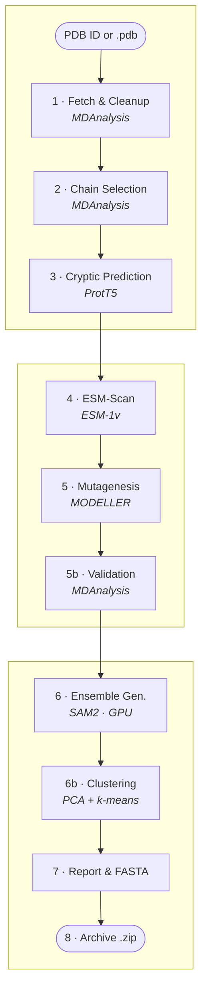

# CryptiScan Pipeline

End-to-end pipeline for predicting cryptic binding sites, designing point mutations with ESM-1v and MODELLER, and generating conformational ensembles with SAM2.




The pipeline runs fully locally inside an Apptainer container (`pipeline_local.sif`). All scripts, dependencies, and model weights are packaged directly in the image. Internet access is only required if downloading structures from RCSB; providing a local `.pdb` file path allows fully offline execution.

---

## How to Run

Configure parameters at the top of `launch_pipeline_local.sh` and run:

```bash
bash launch_pipeline_local.sh
```

### Configuration Options

Edit these variables near the top of `launch_pipeline_local.sh`:

```bash
PDB="1JWP"                     # PDB code or path to a local .pdb file
CHAIN="A"                      # Target chain identifier
TOP=5                          # Number of cryptic residues to mutate
MODE="combined"                # "combined" = one multi-mutant; "independent" = N separate mutants
STRATEGY="esm"                 # Mutation strategy ("esm")
MUTATION_SET="charged_polar"   # Candidate pool: charged_polar | charged | polar | all | "ASP,GLU,..."
N_CLUSTERS=10                  # Number of clusters for SAM2 ensemble
PCA_DIM=10                     # Number of PCA components for clustering
JOBNAME="${JOBNAME:-1jwp}"     # Output folder prefix
MODELLER_KEY="$MODELLER_KEY"  # Sali Lab MODELLER license key
```

Parameters can also be passed as environment variables:

```bash
JOBNAME=1lzt MODELLER_KEY="your_key" bash launch_pipeline_local.sh
```

Before running stage 1, the launcher validates that `pipeline_local.sif` exists, matches required dependencies, and has readable weights.

---

## Output Structure

Results are packaged into `<jobname>_<timestamp>.zip`:

```
<jobname>_<timestamp>/
├── 1jwp_raw.pdb                     Downloaded raw entry from RCSB
├── 1jwp_protein.pdb                 Cleaned protein (all chains)
├── 1jwp_ligands/PO4_A1.pdb          Extracted ligands (one file per residue)
├── 1jwp_prep.json                   Summary of cleaned/dropped residues
├── 1jwp.pdb                         Target chain used for all pipeline stages
├── 1JWP_A_cryptic.json              Predicted cryptic residue positions and probabilities
├── 1jwp_esm_summary.csv             ESM scores for tested substitutions
├── 1jwp_top5_esm_mutant.pdb         Relaxed MODELLER mutant structure
├── sam2_input.pdb                   Structure validated for SAM2
├── ensemble_output.*                SAM2 conformational ensemble trajectory and topology
├── ensemble_clusters/
│   ├── clustering/cluster_representatives.dcd   Representative frame per cluster
│   ├── clustering/cluster_representatives.json  Cluster assignments and population counts
│   └── cluster_meta.sh              Summary counts
├── 1JWP_manifest.json               Run metadata and configuration snapshot
├── 1jwp_local_report.txt            Plaintext summary of the run
├── 1JWP_A_wildtype.fasta            Wild-type sequence of the target chain
└── 1JWP_A_mutant.fasta              Mutated sequence
```

### Key Pipeline Details

- **Cleanup:** Non-standard residues, water molecules, and alternate atom locations are processed with MDAnalysis. Ligands are saved individually in `<pdb>_ligands/` for reference.
- **Chain isolation:** Downstream steps run strictly on the single designated chain (`CHAIN`). Isolating the chain prevents multi-chain coordinate flattening during SAM2 simulation.
- **SAM2 pre-check:** Before running conformational sampling, stage 5b verifies standard atom naming, chain consistency, and CA completeness on the MODELLER output.

---

## Prerequisites

- **Linux** (x86_64)
- **NVIDIA GPU** with driver ≥ 525
- **Apptainer** (or Singularity)
- **MODELLER license key** (free academic license at [salilab.org](https://salilab.org/modeller/registration.html))

CUDA 12.5, PyTorch 2.4, ESM-1v, ProtT5-XL, MODELLER 10.8, and SAM2 are all included in the container.

---

## Project Structure

| File / Directory | Description |
|---|---|
| `launch_pipeline_local.sh` | Main pipeline bash launcher script |
| `pipeline_local.def` | Apptainer recipe definition |
| `pipeline_local.sif` | Container image (~15 GB) |
| `download_weights.sh` | Download helper for model weights |
| `required_files_weights/` | Scripts and weight directories packaged into the image |

### Container Scripts & Environments

The container uses two isolated Python environments to prevent dependency conflicts between MDTraj/PyTorch and MDAnalysis:

| Environment | Path | Packages |
|---|---|---|
| `main` | `/opt/conda` | PyTorch 2.4 (CUDA 12.4), ESM-1v, ProtT5, MODELLER 10.8, SAM2, MDTraj (`numpy==1.26.4`) |
| `prep` | `/opt/conda/envs/prep` | MDAnalysis 2.7.0, SciPy (used for structure cleanup and clustering) |

#### Core scripts in `required_files_weights/`:
- `run_pipeline.py`: Orchestrates stages 1 through 4.
- `predict_cryptic_local.py`: Local ProtT5 cryptic pocket predictor.
- `cryptobank_model_loader.py`: Classification head architecture for ProtT5 embeddings.
- `esm_scanner.py`: ESM-1v in silico mutagenesis scanner.
- `modeller_mutate.py`: Point mutation insertion and sidechain minimization with MODELLER.
- `clean_structure.py`: MDAnalysis structure parsing and chain isolation.
- `asam_cluster_analysis.py`: PCA and k-means clustering of SAM2 trajectories.
- `make_report.py`: Generates the summary report and FASTA files.

---

## Mutation Selection with ESM-Scan

ESM-Scan uses the ESM-1v protein language model to score substitutions at identified cryptic sites:

1. Target chain sequence is evaluated by ESM-1v.
2. Log-probabilities are computed for all 20 standard amino acids at each position:
   $$\text{Score} = \log P(\text{Mutant}) - \log P(\text{WT})$$
3. Alternative substitutions within the allowed set (`MUTATION_SET`, default `charged_polar`) are ranked. The highest-scoring mutation is selected.
4. If a wild-type residue at a predicted cryptic position is already charged or polar, it is skipped and the next ranked cryptic position is evaluated instead.
5. All scores and rankings are exported to `<PDB>_esm_summary.csv`.

---

## Downloading Model Weights

Model weights total ~15 GB and must be downloaded prior to building the container image:

```bash
bash download_weights.sh
```

The script verifies file integrity using SHA-256 checksums and automatically resumes interrupted downloads.

| Weight | Size | Source |
|---|---|---|
| `esm1v_t33_650M_UR90S_1.pt` | 7.3 GB | Meta AI / Facebook Research |
| `prot_t5_xl_uniref50_full_v2/` | 6.8 GB | RostLab / ThorbenF (Hugging Face) |
| `sam2_weights/` | 1.0 GB | `giacomo-janson/sam2` |

Verify files after download:

```bash
du -sh required_files_weights          # ~15 GB expected
find required_files_weights -type l    # should return nothing (no broken symlinks)
```

---

## Building the Container Image

To build `pipeline_local.sif` from `pipeline_local.def`:

```bash
sudo apptainer build pipeline_local.sif pipeline_local.def
chmod 0644 pipeline_local.sif
```

Building requires internet access and roughly 70 GB of temporary disk space. If `/tmp` is small, set `APPTAINER_TMPDIR` to a directory on a larger volume:

```bash
sudo -E APPTAINER_TMPDIR=/path/to/large_disk apptainer build pipeline_local.sif pipeline_local.def
```

Verify the image:

```bash
apptainer test pipeline_local.sif
```

---

## Notes on File Permissions & License

1. **Executable bit:** If files are transferred via cloud storage (e.g., OneDrive or Google Drive), the executable bit may be stripped. Re-enable it with:
   ```bash
   chmod +x launch_pipeline_local.sh download_weights.sh
   ```
2. **MODELLER license:** MODELLER requires an academic license key. Set your key before running:
   ```bash
   export MODELLER_KEY="your_key"
   ```
   or edit `MODELLER_KEY` directly in `launch_pipeline_local.sh`.
