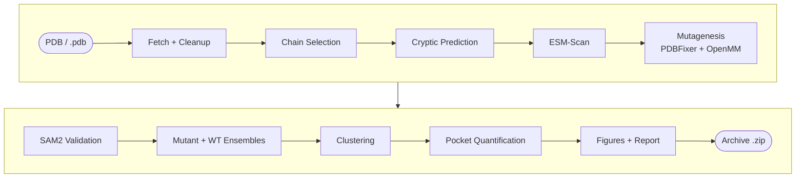

# CryptiScan Pipeline

End-to-end pipeline for predicting cryptic binding sites, designing point mutations with ESM-1v, building them with PDBFixer + OpenMM, generating matched mutant and wild-type conformational ensembles with SAM2, and quantifying the cryptic pocket with fpocket.



The pipeline runs fully locally inside an Apptainer container (`pipeline_local.sif`), which you build once from this repository plus the model weights archived on Zenodo. After the build, all scripts, dependencies, and model weights are packaged in the image. Internet access is then only required if downloading structures from RCSB; providing a local `.pdb` file path allows fully offline execution.

**Archive (Zenodo):** [10.5281/zenodo.23527537](https://doi.org/10.5281/zenodo.23527537)
— prebuilt image, launcher, definition file, and the scripts-plus-weights archive.

---

## Prerequisites

- **Linux** (x86_64)
- **NVIDIA GPU** with driver ≥ 525
- **Apptainer** (or Singularity), with `sudo` or `--fakeroot` rights for the one-time build
- **~70 GB free disk space** for the build, and internet access during the build

No licence keys are needed. CUDA 12.5, PyTorch 2.4, ESM-1v, ProtT5-XL, SAM2, PDBFixer + OpenMM, and fpocket are all installed inside the container during the build.

---

## Quick Start

There are two ways to get a working image. **Option A** downloads the prebuilt
one and skips the build entirely; **Option B** builds it yourself from the
definition file. Both end at the same `Run` step.

---

## Option A — use the prebuilt image (fastest)

Download the image and the launcher from Zenodo
([10.5281/zenodo.23527537](https://doi.org/10.5281/zenodo.23527537)):

```bash
wget -O pipeline_local.sif \
  "https://zenodo.org/records/23527537/files/pipeline_local.sif?download=1"
wget -O launch_pipeline_local.sh \
  "https://zenodo.org/records/23527537/files/launch_pipeline_local.sh?download=1"
chmod 0644 pipeline_local.sif
chmod +x launch_pipeline_local.sh
apptainer test pipeline_local.sif       # optional: re-runs the image self-tests
```

Both files are required. All scripts and model weights are inside the image, but
`launch_pipeline_local.sh` runs on the host and drives it, so the image on its
own will not run. No separate weights download is needed on this path.

Then go to [Run](#4-run).

---

## Option B — build the image yourself

### 1. Get the code

```bash
git clone https://github.com/singhnitink/CryptiScan.git
cd CryptiScan/pipeline
```

Run every command below from this `pipeline/` directory.

### 2. Download the model weights (~15 GB) from Zenodo

The weights are too large for GitHub and are archived on Zenodo ([10.5281/zenodo.23527537](https://doi.org/10.5281/zenodo.23527537)). The archive also contains the driver scripts, so unzipping it populates `required_files_weights/` completely.

```bash
wget -O cryptiscan_weights.zip "https://zenodo.org/records/23527537/files/cryptiscan_weights.zip?download=1"
md5sum cryptiscan_weights.zip     # compare against the MD5 shown on the Zenodo record
unzip -o cryptiscan_weights.zip   # fills required_files_weights/
```

Check the download:

```bash
du -sh required_files_weights          # ~15 GB expected
find required_files_weights -type l    # should return nothing (no broken symlinks)
```

### 3. Build the container (one time)

```bash
sudo apptainer build pipeline_local.sif pipeline_local.def
chmod 0644 pipeline_local.sif
```

Build from `pipeline/`: the recipe copies `../sample_output/2wgb.pdb` into the image as test data.

Without `sudo`, use `apptainer build --fakeroot pipeline_local.sif pipeline_local.def` if your system allows it. To replace an existing image, add `--force`.

If `/tmp` is small, point the build to a larger disk:

```bash
sudo -E APPTAINER_TMPDIR=/path/to/large_disk apptainer build pipeline_local.sif pipeline_local.def
```

The build ends by running the image's self-tests, which include two real point mutations (F121R, G124R) on the 2WGB sample chain. Re-run them at any time with:

```bash
apptainer test pipeline_local.sif
```

### 4. Run

```bash
bash launch_pipeline_local.sh
```

Edit the target protein and other parameters at the top of `launch_pipeline_local.sh` (see below).

---

## Configuration Options

Edit these variables near the top of `launch_pipeline_local.sh`:

```bash
PDB="1JWP"                     # PDB code or path to a local .pdb file
CHAIN="A"                      # Target chain identifier
TOP=5                          # Number of cryptic residues to mutate
MODE="combined"                # "combined" = one multi-mutant; "independent" = N separate mutants
STRATEGY="esm"                 # Mutation strategy ("esm")
MUTATION_SET="charged_polar"   # Candidate pool: charged_polar | charged | polar | all | "ASP,GLU,..."
N_CLUSTERS=10                  # Number of clusters for SAM2 ensemble
PCA_DIM=10                     # Number of PCA components for clustering
JOBNAME="${JOBNAME:-1jwp}"     # Output folder prefix
```

`JOBNAME` can also be passed as an environment variable:

```bash
JOBNAME=1lzt bash launch_pipeline_local.sh
```

Before running stage 1, the launcher validates that `pipeline_local.sif` exists, matches required dependencies, and has readable weights.

---

## Output Structure

Results are packaged into `<jobname>_<timestamp>.zip`:

```
<jobname>_<timestamp>/
├── 1jwp_raw.pdb                     Downloaded raw entry from RCSB
├── 1jwp_protein.pdb                 Cleaned protein (all chains)
├── 1jwp_ligands/PO4_A1.pdb          Extracted ligands (one file per residue)
├── 1jwp_prep.json                   Summary of cleaned/dropped residues
├── 1jwp.pdb                         Target chain used for all pipeline stages
├── 1JWP_A_cryptic.json              Predicted cryptic residue positions and probabilities
├── 1jwp_esm_summary.csv             ESM scores for tested substitutions
├── 1jwp_top5_esm_mutant.pdb         Relaxed mutant structure (PDBFixer + OpenMM)
├── mutate_<RES><num>.log            Per-mutation log: energies, mobile atoms, fixed-atom drift
├── sam2_input.pdb                   Structure validated for SAM2
├── ensemble_output.*                SAM2 ensemble of the MUTANT (trajectory and topology)
├── wt_ensemble.*                    Matched SAM2 ensemble of the WILD TYPE (same settings)
├── ensemble_clusters/
│   ├── clustering/cluster_representatives.dcd   Representative frame per cluster
│   ├── clustering/cluster_representatives.json  Cluster assignments and population counts
│   └── cluster_meta.sh              Summary counts
├── pocket_analysis/                 Per-frame cryptic-pocket volumes for both ensembles (fpocket)
├── figures/                         Figures and statistics table (stats_summary.csv)
├── 1JWP_manifest.json               Run metadata and configuration snapshot
├── 1jwp_local_report.txt            Plaintext summary of the run
├── 1JWP_A_wildtype.fasta            Wild-type sequence of the target chain
└── 1JWP_A_mutant.fasta              Mutated sequence
```

### Key Pipeline Details

- **Cleanup:** Non-standard residues, water molecules, and alternate atom locations are processed with MDAnalysis. Ligands are saved individually in `<pdb>_ligands/` for reference.
- **Chain isolation:** Downstream steps run strictly on the single designated chain (`CHAIN`). Isolating the chain prevents multi-chain coordinate flattening during SAM2 simulation.
- **Mutagenesis:** PDBFixer swaps the residue and builds the new side chain; any heavy atoms missing elsewhere in the chain are rebuilt too. OpenMM then relaxes the structure (Amber14 force field, GBn2 implicit solvent): minimise, anneal 300 → 600 → 300 K, minimise again. Only the side chains of the mutated (and rebuilt) residues and the hydrogens move; the backbone and every other atom stay fixed. Hydrogens are removed before writing, chain IDs and residue numbers are kept, and a fixed random seed makes runs reproducible. In `combined` mode mutations are applied one after another, each relaxed in the presence of the previous ones.
- **SAM2 pre-check:** Before running conformational sampling, stage 5b verifies standard atom naming, chain consistency, and CA completeness on the mutant structure.

---

## Project Structure

| File / Directory | Description |
|---|---|
| `launch_pipeline_local.sh` | Main pipeline bash launcher script |
| `pipeline_local.def` | Apptainer recipe definition |
| `pipeline_local.sif` | Container image (~15 GB). Download prebuilt (Option A) or build it (Option B). Not stored in this repository. |
| `download_weights.sh` | Alternative: fetches weights from the original sources instead of Zenodo |
| `SHA256SUMS` | Expected SHA-256 of every weight file; read by `download_weights.sh` |
| `required_files_weights/` | Scripts (in this repository) + model weights (from Zenodo, or `download_weights.sh`) |
| `THIRD_PARTY.md` | Licence of every third-party component in the image |

### Container Scripts & Environments

The container uses four isolated Python environments, so that no tool's dependencies can move the pinned PyTorch / MDTraj / NumPy stack:

| Environment | Path | Packages |
|---|---|---|
| `main` | `/opt/conda` | PyTorch 2.4 (CUDA 12.4), ESM-1v, ProtT5, SAM2, MDTraj (`numpy==1.26.4`) |
| `prep` | `/opt/conda/envs/prep` | MDAnalysis 2.7.0, SciPy (used for structure cleanup and clustering) |
| `mutate` | `/opt/conda/envs/mutate` | PDBFixer + OpenMM from conda-forge (exact versions recorded in `/opt/pipeline/MUTATE_VERSION.txt`) |
| `analysis` | `/opt/conda/envs/analysis` | fpocket (build recorded in `/opt/pipeline/FPOCKET_VERSION.txt`) |

#### Core scripts in `required_files_weights/`:
- `run_pipeline.py`: Orchestrates stages 1 through 6.
- `predict_cryptic_local.py`: Local ProtT5 cryptic pocket predictor.
- `cryptobank_model_loader.py`: Classification head architecture for ProtT5 embeddings.
- `esm_scanner.py`: ESM-1v in silico mutagenesis scanner.
- `openmm_mutate.py`: Point mutation with PDBFixer and side-chain relaxation with OpenMM.
- `clean_structure.py`: MDAnalysis structure parsing and chain isolation.
- `asam_cluster_analysis.py`: PCA and k-means clustering of SAM2 trajectories.
- `cryptic_pocket_analysis.py`: Guided fpocket quantification of the cryptic pocket in both ensembles.
- `plot_cryptiscan.py`: Figures and statistics.
- `make_report.py`: Generates the summary report and FASTA files.

`modeller_mutate.py` is the earlier MODELLER-based mutagenesis step. It is kept for reference only and is not part of the image.

---

## Mutation Selection with ESM-Scan

ESM-Scan uses the ESM-1v protein language model to score substitutions at identified cryptic sites:

1. Target chain sequence is evaluated by ESM-1v.
2. Log-probabilities are computed for all 20 standard amino acids at each position:
   $$\text{Score} = \log P(\text{Mutant}) - \log P(\text{WT})$$
3. Alternative substitutions within the allowed set (`MUTATION_SET`, default `charged_polar`) are ranked. The highest-scoring mutation is selected.
4. If a wild-type residue at a predicted cryptic position is already charged or polar, it is skipped and the next ranked cryptic position is evaluated instead.
5. All scores and rankings are exported to `<PDB>_esm_summary.csv`.

---

## Model Weights

The weights archive on Zenodo (Quick Start step 2) contains:

| Weight | Size | Source |
|---|---|---|
| `esm1v_t33_650M_UR90S_1.pt` | 7.3 GB | Meta AI / Facebook Research |
| `prot_t5_xl_uniref50_full_v2/` | 6.8 GB | RostLab / ThorbenF (Hugging Face) |
| `sam2_weights/` | 1.0 GB | `giacomo-janson/sam2` |

Alternatively, download them from the original sources:

```bash
bash download_weights.sh
```

Each file is verified against the SHA-256 checksums in `SHA256SUMS`. Downloads are
written to a temporary name and only moved into place once they verify, so an
interrupted transfer is resumed rather than restarted and can never be mistaken
for a complete file on a later run. A file already present is re-verified rather
than trusted; one that fails is re-fetched. A failed download is retried up to
three times.

---

## Notes on File Permissions & Licences

1. **Executable bit:** If files are transferred via cloud storage (e.g., OneDrive or Google Drive), the executable bit may be stripped. Re-enable it with:
   ```bash
   chmod +x launch_pipeline_local.sh download_weights.sh
   ```
2. **Licences:** Every component in the image is redistributable, so no licence key or registration is required. See [THIRD_PARTY.md](THIRD_PARTY.md) for the licence of each component.

---

## Citation

If you use CryptiScan, please cite:

> [Manuscript citation, to be added]

Archive (image, launcher and weights): Routh, R., Singh, N. K. & Radhakrishna, M.
*CryptiScan: container image and model weights*. Zenodo (2026).
https://doi.org/10.5281/zenodo.23527537
